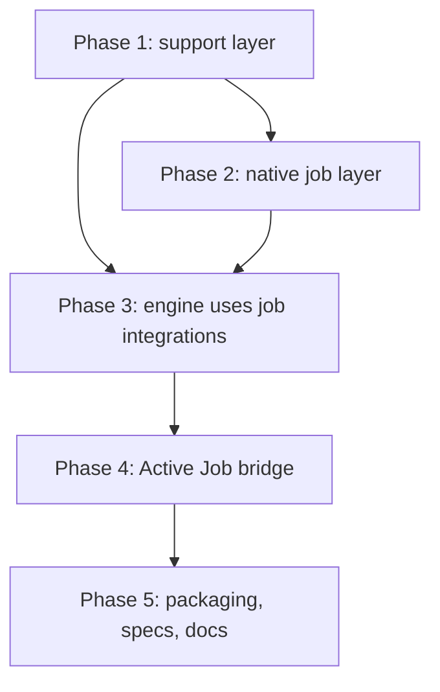

# Native job layer plan

## Goal

The core gem must depend only on `pg`. It must have its own job API, `DecentJob::Base`. The Active Job support must become an optional bridge on top of the native layer.

Approved decisions:

- Remove both `activejob` and `activesupport` from the runtime dependencies.
- The native layer supports enqueue, perform, `set`, bulk enqueue, callbacks, `retry_on`, `discard_on`, and `rescue_from`.
- The native base class is `DecentJob::Base`. `DecentJob::Job` stays the job-row model.
- Stored payloads use the same keys as the `ActiveJob::Base#serialize` hash.

## Phases



Each phase must end with a passing `bundle exec rake` and `bundle exec standardrb`. Each phase is one session of work.

## Phase 1: support layer

This phase replaces ActiveSupport inside the engine. It does not change behavior. Active Job stays loaded during this phase.

- [x] Add `DecentJob::Notifications`. It must support `instrument`, `subscribe` (string or regexp), `unsubscribe`, `subscribed`, and start/finish handles for `Instrumentation`.
- [x] Forward every `*.decent_job` event to `ActiveSupport::Notifications` when it is loaded. Rails users can then keep their subscribers.
- [x] Add `DecentJob::IsolatedState`. Delegate to `ActiveSupport::IsolatedExecutionState` when it is loaded, so the Rails isolation level and `share_with` still apply. Otherwise use thread-level storage.
- [x] Move `ExecutionState`, `Database`, `LifecycleEvents`, and `Instrumentation` to `IsolatedState`.
- [x] Rebuild `LogSubscriber` on `Notifications`. Use stdlib `Logger`. Add a small tagged formatter and a broadcast list. Use `#tagged` when the destination logger has it, for example `Rails.logger`.
- [x] Replace core extensions: `constantize`, `deep_dup`, `blank?`, and `pluralize`. `class_attribute` and `ActiveSupport::Concern` are only in `active_job_extensions/`, so they move with the bridge in Phase 4. The usage is in `configuration.rb`, `cron_entry.rb`, `execution.rb`, `job.rb`, `log_subscriber.rb`, `stats.rb`, and `cleaner.rb`.
- [x] Add a subprocess spec. It must require only the support files and assert that `ActiveSupport` is not defined.

Phase 1 verification: 1,824 runs, 8,583 assertions, 0 failures, 4 skips. Standard passed. Remaining ActiveSupport references in the engine are the `*.active_job` subscriptions in `Performer` and `JobRetry` (Phase 3) and the Railtie (Rails only).

`Support.blank?` calls the value's own `blank?` when one exists. With ActiveSupport loaded, the behavior does not change. The log subscriber listens on `DecentJob::Notifications`. Events sent only to `ActiveSupport::Notifications` are not logged, so two logging specs now instrument through the DecentJob bus.

## Phase 2: native job layer

The new files go in `lib/decent_job/base.rb` and `lib/decent_job/base/`.

### Public API

```ruby
class ReportJob < DecentJob::Base
  queue_as :reports
  queue_with_priority 10
  retry_on Net::ReadTimeout, wait: :polynomially_longer, attempts: 5
  discard_on ArgumentError
  before_perform { |job| ... }

  def perform(account_id, period:)
  end
end

ReportJob.perform_later(1, period: "2026-09")
ReportJob.perform_now(1, period: "2026-09")
ReportJob.set(wait: 300, queue: :urgent, priority: 1).perform_later(1, period: "2026-09")
ReportJob.set(wait_until: Time.now + 3600).perform_later(1, period: "2026-09")
DecentJob.perform_all_later(job_a, job_b)
```

### Requirements

- [x] Instance attributes: `job_id`, `queue_name`, `priority`, `arguments`, `executions`, `exception_executions`, `scheduled_at`, `enqueued_at`, `provider_job_id`, `successfully_enqueued?`, `enqueue_error`.
- [x] `serialize` and `deserialize` must use the Active Job payload keys. Native payloads must not need any Active Job code to run.
- [x] Add `DecentJob::Arguments`. It must encode the same types as `ActiveJob::Arguments`, with the same `_aj_*` markers. Batch properties that are already stored must stay readable.
- [x] `Arguments` must have a custom serializer registry. A GlobalID serializer must activate only when `GlobalID` is loaded.
- [x] Durations are numeric seconds. Any object with `to_f`, such as `ActiveSupport::Duration`, is also accepted. `retry_on wait:` uses `to_i`, as Active Job does.
- [x] Callbacks: `before`, `after`, and `around` for `enqueue` and `perform`. Each callback can take `if:` and `unless:`.
- [x] `retry_on` must support `wait:` (number, proc, or `:polynomially_longer`), `attempts:` (integer or `:unlimited`), `queue:`, `priority:`, `jitter:`, and a block for the exhausted case.
- [x] `discard_on` and `rescue_from` must match Active Job semantics, including the order of the handlers.
- [x] Class settings must inherit to subclasses without ActiveSupport.
- [x] `perform_later` must return the job on success. It must return `false` when the enqueue fails. It must set `enqueue_error` when the adapter or a concurrency limit rejects the job, and leave it `nil` when a callback aborts.
- [x] `perform_now` must run the callbacks and the retry handlers, as in Active Job.

Phase 2 verification: 1,848 runs, 8,655 assertions, 0 failures, 4 skips. Standard passed. The GlobalID argument spec was added after that run and passes on its own.

### Phase 2 notes

- Files: `lib/decent_job/arguments.rb`, `lib/decent_job/base.rb`, `lib/decent_job/base/callbacks.rb`, `lib/decent_job/base/exceptions.rb`.
- Native values store our serializer names, for example `DecentJob::Arguments::SymbolSerializer`. Reading also accepts the `ActiveJob::Serializers::*` names. Active Job cannot read the native names, and nothing needs it to.
- `ActiveSupport::Duration`, `TimeWithZone`, `HashWithIndifferentAccess`, and GlobalID values are encoded only when the host loads those classes.
- `perform_now` records how a handled error ended in `job.decent_job_outcome`: `[:retried, error]`, `[:discarded, error]`, or `[:retry_stopped, error]`. Phase 3 builds `Outcome` from it.
- Native jobs without their own `queue_adapter` share `DecentJob.default_adapter`. `reset!` clears it.
- The engine `Adapter` already stores native jobs, because it only duck-types the job. A spec covers this. Running stored native jobs needs Phase 3.
- Not included: `locale`, `timezone`, `report:` on `retry_on` and `discard_on`, and object callback filters.

## Phase 3: engine uses job integrations

The engine must stop referring to `ActiveJob` directly. It talks to a job integration instead. The native layer is the first integration.

### Integration interface

The registry is `DecentJob::Integrations` in `lib/decent_job/integrations.rb`. The Active Job integration is in `lib/decent_job/active_job_extensions/integration.rb`.

```ruby
integration.handles?(job_class)          # => true or false
integration.deserialize(payload)         # => job instance
integration.execute(payload, outcome)    # => perform value, or the handled error
integration.serialize_core(job)          # => payload without extension metadata
integration.enqueue_error(error)         # => error raised to enqueue callers
integration.deserialization_error        # => error class for unloadable arguments
integration.with_context(job) { }        # => runs a manual retry in the job's context
integration.discarding(job, error) { }   # => wraps an operator discard
```

`Outcome` is a mutable struct with `job_instance`, `state`, `error`, and `error_event`. The integration fills it in while the job runs, so it stays correct when the job raises. The approved plan returned an `Outcome`, but a return value is lost when the job raises.

### Changes by file

- [x] `Performer`: call `integration.execute` and read the `Outcome`.
- [x] `Job`, `BatchStore`, `JobRetry`: deserialize through the integration that handles the job class.
- [x] `Batch`, `Bulk`, `CronEntry`, `BatchStore`, `DecentJob.start_cron`: replace `ActiveJob::Base` checks with integration lookup.
- [x] Add `DecentJob::EnqueueError`. The engine raises it. `Adapter#enqueue`, `#enqueue_at`, `#enqueue_all`, and `#reschedule` convert it to the integration's error class, so Active Job callers still get `ActiveJob::EnqueueError`.
- [x] Move labels, notify options, concurrency, interrupt errors, batches, and cron validation into `lib/decent_job/job_extensions/`. The `ActiveJobExtensions` constants are aliases, except `Concurrency`.
- [x] Concurrency admission runs after all user `before_enqueue` callbacks. Native jobs call it from `Base#before_adapter_enqueue`. Active Job keeps the named callback and the reordering, because `skip_callback(:enqueue, :before, :_decent_job_concurrency_before_enqueue)` is a documented way to skip the check.
- [x] Move `ConcurrencyExceededError` and `ThrottleExceededError` to `DecentJob`.
- [x] Add native specs for perform, retry, discard, management, batches, concurrency, labels, and bulk (`spec/native_execution_spec.rb`).

Phase 3 verification: two full runs of 1,855 runs. Each run had one different timing failure: `daemon_cli_spec.rb` in the first run and `health_status_spec.rb` in the second. Both files pass three times out of three when run alone. Standard passed.

### Renames

The deserialized object, native or Active Job, is the "job instance". `DecentJob::Job` stays the database row.

- `Job#active_job` is now `Job#job_instance`.
- `Batch#active_jobs` and `#callback_active_jobs` are now `#job_instances` and `#callback_job_instances`.
- The `enqueue_job.decent_job` payload key `:active_job` is now `:job_instance`.
- `Pauses#paused?(active_job:)` is now `paused?(job_instance:)`.
- `Bulk::Buffer#active_jobs` is now `#jobs`.

The `active_job_id` column and `active_job_ids` event key keep their names. Renaming them needs a schema migration.

### Other changes

- Native jobs include labels, notify options, concurrency, batches, and cron validation by default. `InterruptErrors` stays opt-in, because it changes how an interrupted job ends.
- `DecentJob::Base` instance methods are in `Base::Core`, so extensions can wrap them with `super`.
- Batch properties use `DecentJob::Arguments` and raise `DecentJob::SerializationError` and `DecentJob::DeserializationError`.
- `Batch` arguments are written as GlobalID strings through `decent_job_global_id`, without the `globalid` gem.
- `enqueue_job.decent_job` events report `DecentJob::EnqueueError`, the error raised inside the engine.

## Phase 4: Active Job bridge

- [x] Add `lib/decent_job/active_job.rb`. It loads Active Job and the extensions, registers the integration, includes `GlobalID::Identification` in `Batch`, and sets `Arguments.fallback` to `ActiveJob::Serializers`.
- [x] `require "decent_job"` does not load Active Job, ActiveSupport, or GlobalID. `require "decent_job/active_job"` loads the bridge.
- [x] `lib/active_job/queue_adapters/decent_job_adapter.rb` requires the bridge. `decent_job.rb` registers the adapter autoload when Active Job is already loaded, so `queue_adapter = :decent_job` works without an extra require.
- [x] The Railtie loads the bridge from `ActiveSupport.on_load(:active_job)`.
- [x] The bridge integration owns the `*.active_job` subscription (Phase 3).
- [x] The bridge converts `DecentJob::EnqueueError` to `ActiveJob::EnqueueError` (Phase 3, in `Adapter`).

Phase 4 verification: 1,855 runs, 8,687 assertions, 0 failures, 4 skips (seed 23889). The seed that failed before the daemon spec fix (65179) also passes. `BUNDLE_GEMFILE=gemfiles/rails.gemfile bundle exec rake spec:rails`: 34 runs, 231 assertions, 0 failures. Standard passed. The PgBouncer spec was not run.

### Phase 4 notes

- The extension files stay in `lib/decent_job/active_job_extensions/`, and the constants keep their names. Moving them would only rename files.
- `decent_job.rb` does not load the bridge on its own when Active Job is present, because the bridge requires `decent_job` and that would be a circular require. A plain Ruby app that uses Active Job must `require "decent_job/active_job"` or set `queue_adapter = :decent_job`.
- With the bridge loaded, values that no native serializer handles go to `ActiveJob::Serializers`. Custom Active Job serializers then work for native jobs and batch properties.
- The CLI loads DecentJob before the application. Before Phase 4, Active Job loaded ActiveSupport, so the Railtie hook (`on_load(:before_configuration)`) was always registered. Now the CLI tries `require "active_support"` before it requires application files, then registers the hook. When ActiveSupport is not installed, the CLI skips this. The library itself never loads ActiveSupport.
- `spec_helper.rb` and the spec support scripts that use Active Job require the bridge.
- Several async specs leave stopped workers registered, because their `after` blocks do not call `DecentJob.reset!`. When a daemon CLI spec ran next, CLI configuration drained that worker and the spec failed, depending on test order. `daemon_cli_spec.rb` now resets the runtime before each test. This leak existed before the native work.

## Phase 5: packaging, specs, docs

- [x] Gemspec: runtime dependency on `pg` only. `activejob` is in the Gemfile development group.
- [x] `spec_helper.rb` requires the bridge, so the existing Active Job specs run against it (Phase 4).
- [x] `spec/native_execution_spec.rb` starts a process that loads only `decent_job`. It stores a native job in PostgreSQL, retries it, and performs it, then asserts that Active Job, ActiveSupport, and GlobalID are not defined.
- [x] `spec/packaging_spec.rb` checks that the built gem depends only on `pg`. The unpacked gem boots with only `pg` activated, and the adapter lookup works when `activejob` is activated.
- [x] Run the Rails integration spec and the PgBouncer spec.
- [x] Update `README.md`, `rails-integration.md`, `instrumentation.md`, `job-management.md`, `parity.md`, `pgbouncer.md`, and `implementation-plan.md`. Add `docs/native-jobs.md`.

Phase 5 verification: `bundle exec rake` with seed 2464 passed 1,856 runs and 8,693 assertions, with 0 failures and 4 skips. The first run with that seed had two timeouts (`pauses_spec.rb` and `supervisor_process_spec.rb`). Each file passes three times out of three when run alone. `rake spec:rails` (Rails gemfile): 34 runs, 0 failures. `rake spec:pgbouncer`: 14 runs, 0 failures. Standard and `gem build` passed.

## Open questions

- Resolved in Phase 3: `Job#active_job` is now `Job#job_instance`, and the `:active_job` event payload key is now `:job_instance`.
- Resolved in Phase 2: native jobs do not write `locale` or `timezone`.
- Open: the `active_job_id` column and the `active_job_ids` event key keep their names. Renaming them needs a schema migration.
