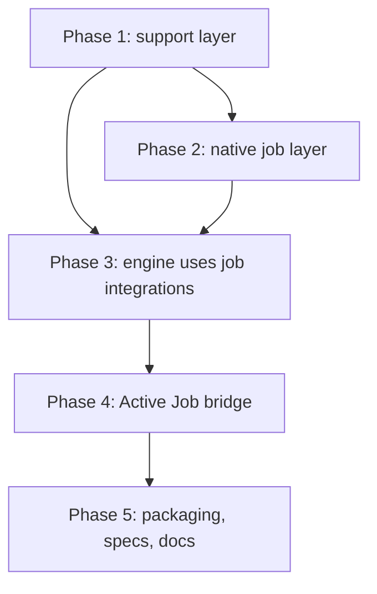

# Native job layer plan

## Goal

The core gem must depend only on `pg`. It must have its own job API, `DecentJob::Base`. The Active Job support must become an optional bridge on top of the native layer.

Approved decisions:

- Remove both `activejob` and `activesupport` from the runtime dependencies.
- The native layer supports enqueue, perform, `set`, bulk enqueue, callbacks, `retry_on`, `discard_on`, and `rescue_from`.
- The native base class is `DecentJob::Base`. `DecentJob::Job` stays the job-row model.
- Stored payloads use the same keys as the `ActiveJob::Base#serialize` hash.

## Phases



Each phase must end with a passing `bundle exec rake` and `bundle exec standardrb`. Each phase is one session of work.

## Phase 1: support layer

This phase replaces ActiveSupport inside the engine. It does not change behavior. Active Job stays loaded during this phase.

- [x] Add `DecentJob::Notifications`. It must support `instrument`, `subscribe` (string or regexp), `unsubscribe`, `subscribed`, and start/finish handles for `Instrumentation`.
- [x] Forward every `*.decent_job` event to `ActiveSupport::Notifications` when it is loaded. Rails users can then keep their subscribers.
- [x] Add `DecentJob::IsolatedState`. Delegate to `ActiveSupport::IsolatedExecutionState` when it is loaded, so the Rails isolation level and `share_with` still apply. Otherwise use thread-level storage.
- [x] Move `ExecutionState`, `Database`, `LifecycleEvents`, and `Instrumentation` to `IsolatedState`.
- [x] Rebuild `LogSubscriber` on `Notifications`. Use stdlib `Logger`. Add a small tagged formatter and a broadcast list. Use `#tagged` when the destination logger has it, for example `Rails.logger`.
- [x] Replace core extensions: `constantize`, `deep_dup`, `blank?`, and `pluralize`. `class_attribute` and `ActiveSupport::Concern` are only in `active_job_extensions/`, so they move with the bridge in Phase 4. The usage is in `configuration.rb`, `cron_entry.rb`, `execution.rb`, `job.rb`, `log_subscriber.rb`, `stats.rb`, and `cleaner.rb`.
- [x] Add a subprocess spec. It must require only the support files and assert that `ActiveSupport` is not defined.

Phase 1 verification: 1,824 runs, 8,583 assertions, 0 failures, 4 skips. Standard passed. Remaining ActiveSupport references in the engine are the `*.active_job` subscriptions in `Performer` and `JobRetry` (Phase 3) and the Railtie (Rails only).

`Support.blank?` calls the value's own `blank?` when one exists. With ActiveSupport loaded, the behavior does not change. The log subscriber listens on `DecentJob::Notifications`. Events sent only to `ActiveSupport::Notifications` are not logged, so two logging specs now instrument through the DecentJob bus.

## Phase 2: native job layer

The new files go in `lib/decent_job/base.rb` and `lib/decent_job/base/`.

### Public API

```ruby
class ReportJob < DecentJob::Base
  queue_as :reports
  queue_with_priority 10
  retry_on Net::ReadTimeout, wait: :polynomially_longer, attempts: 5
  discard_on ArgumentError
  before_perform { |job| ... }

  def perform(account_id, period:)
  end
end

ReportJob.perform_later(1, period: "2026-09")
ReportJob.perform_now(1, period: "2026-09")
ReportJob.set(wait: 300, queue: :urgent, priority: 1).perform_later(1, period: "2026-09")
ReportJob.set(wait_until: Time.now + 3600).perform_later(1, period: "2026-09")
DecentJob.perform_all_later(job_a, job_b)
```

### Requirements

- [x] Instance attributes: `job_id`, `queue_name`, `priority`, `arguments`, `executions`, `exception_executions`, `scheduled_at`, `enqueued_at`, `provider_job_id`, `successfully_enqueued?`, `enqueue_error`.
- [x] `serialize` and `deserialize` must use the Active Job payload keys. Native payloads must not need any Active Job code to run.
- [x] Add `DecentJob::Arguments`. It must encode the same types as `ActiveJob::Arguments`, with the same `_aj_*` markers. Batch properties that are already stored must stay readable.
- [x] `Arguments` must have a custom serializer registry. A GlobalID serializer must activate only when `GlobalID` is loaded.
- [x] Durations are numeric seconds. Any object with `to_f`, such as `ActiveSupport::Duration`, is also accepted. `retry_on wait:` uses `to_i`, as Active Job does.
- [x] Callbacks: `before`, `after`, and `around` for `enqueue` and `perform`. Each callback can take `if:` and `unless:`.
- [x] `retry_on` must support `wait:` (number, proc, or `:polynomially_longer`), `attempts:` (integer or `:unlimited`), `queue:`, `priority:`, `jitter:`, and a block for the exhausted case.
- [x] `discard_on` and `rescue_from` must match Active Job semantics, including the order of the handlers.
- [x] Class settings must inherit to subclasses without ActiveSupport.
- [x] `perform_later` must return the job on success. It must return `false` when the enqueue fails, and set `enqueue_error`.
- [x] `perform_now` must run the callbacks and the retry handlers, as in Active Job.

Phase 2 verification: 1,848 runs, 8,655 assertions, 0 failures, 4 skips. Standard passed. The GlobalID argument spec was added after that run and passes on its own.

### Phase 2 notes

- Files: `lib/decent_job/arguments.rb`, `lib/decent_job/base.rb`, `lib/decent_job/base/callbacks.rb`, `lib/decent_job/base/exceptions.rb`.
- Native values store our serializer names, for example `DecentJob::Arguments::SymbolSerializer`. Reading also accepts the `ActiveJob::Serializers::*` names. Active Job cannot read the native names, and nothing needs it to.
- `ActiveSupport::Duration`, `TimeWithZone`, `HashWithIndifferentAccess`, and GlobalID values are encoded only when the host loads those classes.
- `perform_now` records how a handled error ended in `job.decent_job_outcome`: `[:retried, error]`, `[:discarded, error]`, or `[:retry_stopped, error]`. Phase 3 builds `Outcome` from it.
- Native jobs without their own `queue_adapter` share `DecentJob.default_adapter`. `reset!` clears it.
- The engine `Adapter` already stores native jobs, because it only duck-types the job. A spec covers this. Running stored native jobs needs Phase 3.
- Not included: `locale`, `timezone`, `report:` on `retry_on` and `discard_on`, and object callback filters.

## Phase 3: engine uses job integrations

The engine must stop referring to `ActiveJob` directly. It talks to a job integration instead. The native layer is the first integration.

### Integration interface

```ruby
# Registered with DecentJob.register_integration(integration)
integration.handles?(job_class)     # => true or false
integration.deserialize(payload)    # => job object
integration.execute(payload)        # => DecentJob::Outcome
integration.enqueue_error(message)  # => exception class to raise to callers
```

`Outcome` holds `state` (succeeded, retried, discarded), `error`, `error_event`, and `value`. With this interface, `Performer` no longer subscribes to `*.active_job` events to find the outcome.

### Changes by file

- [ ] `Performer`: call `integration.execute` and use the returned `Outcome`.
- [ ] `Store`, `Job`, `BatchStore`, `JobRetry`: deserialize through the integration that handles the job class.
- [ ] `Batch`, `Bulk`, `CronEntry`, `BatchStore`: replace `is_a?(ActiveJob::Base)` checks with integration lookup.
- [ ] Add `DecentJob::EnqueueError`. Replace the `ActiveJob::EnqueueError` raises in the engine with it.
- [ ] Move labels, notify options, concurrency, interrupt errors, batches, and cron validation out of `active_job_extensions/` into shared modules. Both job kinds include the same modules.
- [ ] Concurrency admission must run after all user `before_enqueue` callbacks. The native callback chain must do this without the callback reorder hack in `Concurrency.move_decent_job_enqueue_check_last`.
- [ ] `PerformControls`: move `ConcurrencyExceededError` and `ThrottleExceededError` to `DecentJob`.
- [ ] Add native specs for enqueue, perform, retry, discard, batches, cron, concurrency, and bulk.

## Phase 4: Active Job bridge

- [ ] Move the Active Job code to `lib/decent_job/active_job.rb` and `lib/decent_job/active_job/`.
- [ ] `require "decent_job"` must not load Active Job. `require "decent_job/active_job"` loads the bridge.
- [ ] `lib/active_job/queue_adapters/decent_job_adapter.rb` must require the bridge. Then `config.active_job.queue_adapter = :decent_job` works without an extra require.
- [ ] The Railtie must load the bridge when Active Job is loaded.
- [ ] The bridge integration moves the `*.active_job` subscription out of `Performer`. It converts those events into an `Outcome`.
- [ ] The bridge adapter rescues `DecentJob::EnqueueError` and raises `ActiveJob::EnqueueError`, because `perform_later` returns `false` only for that class.

## Phase 5: packaging, specs, docs

- [ ] Gemspec: runtime dependency on `pg` only. Add `activejob` to the Gemfile development group.
- [ ] `spec_helper.rb` requires the bridge, so the existing Active Job specs keep running against it.
- [ ] Add a subprocess spec. It must run a native job end to end with only `require "decent_job"`. It must assert that `ActiveJob` and `ActiveSupport` are not defined.
- [ ] Run the Rails integration spec (`rake spec:rails`) and the PgBouncer spec.
- [ ] Update `README.md`, `rails-integration.md`, `instrumentation.md`, and `parity.md`. Add a native job guide.

## Open questions

- `Job#active_job` returns a deserialized job. Native jobs need a name that does not say "active job". A rename changes the public API, so it needs approval in Phase 3.
- The event payload key `:active_job` in `enqueue_job.decent_job` has the same problem.
- Native jobs could skip the `locale` and `timezone` payload keys. Active Job jobs keep them.
